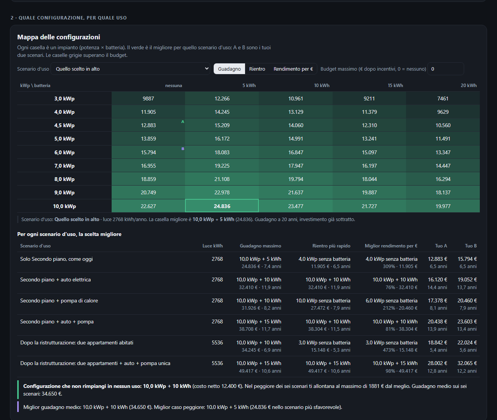
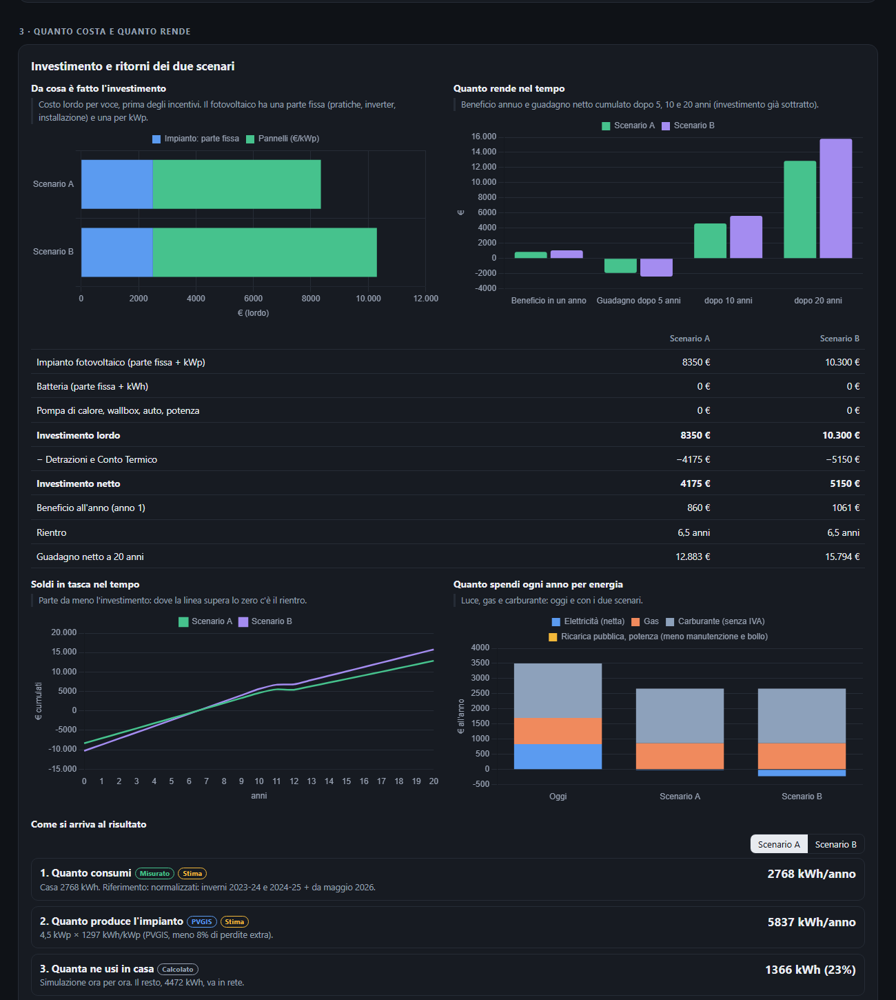
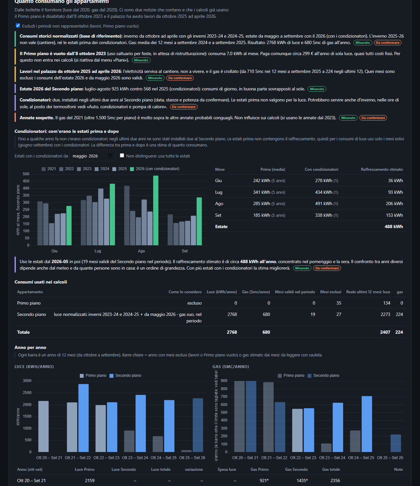

# ☀️ Simulatore fotovoltaico

**Conviene davvero il fotovoltaico? Questo simulatore lo calcola ora per ora**, a partire dalle bollette reali di una casa, e dice quale impianto rende di più per ogni modo di usarla: oggi, con un'auto elettrica, con una pompa di calore, con i condizionatori usati anche d'inverno.

È una pagina web unica, senza server e senza installazioni: apri `index.html` e funziona (oppure usa GitHub Pages).

> I dati inclusi sono **di esempio**: consumi reali di una casa del Sud Italia, scalati e privi di indirizzo, codici cliente, targhe e nomi di fornitori. Mostrano come funziona il metodo, non una casa vera.


## Cosa trovi

| | |
|---|---|
| 🎯 **Cosa conviene** | Un suggerimento in parole semplici, calcolato su 6 modi diversi di usare la casa, con il confronto tra due scenari (A e B). |
| 🗺️ **Mappa delle configurazioni** | 45 combinazioni di potenza (3–10 kWp) e batteria (0–20 kWh), con guadagno, rientro e rendimento per euro. Si vede dove conviene fermarsi. |
| 💶 **Costi e ritorni** | Da cosa è fatto l'investimento, incentivi, flusso di cassa a 20 anni, anni per rientrare. |
| 🌶️ **Cosa pesa di più** | Sensibilità: di quanto cambia il guadagno se prezzo di cessione, detrazione o costo dei pannelli cambiano. |
| 📈 **Consumi e prezzi nel tempo** | Luce, gas e gasolio mese per mese, con i periodi non rappresentativi esclusi. |
| 🔋 **Impianto e batteria** | Produzione mese per mese, quanta ne usi, quanta ne vendi, acquisti per fascia oraria F1/F2/F3, giornata tipo. |
| 🚗🌡️ **Auto, condizionatori, pompa di calore** | Ognuna con il suo conto e il suo rientro, e le combinazioni. |
| ⚡ **Scenari rapidi** | Sette tasti (ATT, NORM, EV, CLI, EV+CLI, PDC, FUT) che cambiano tutte le variabili in un click. |





## Come è fatto

- `index.html`: l'interfaccia (HTML, CSS e JavaScript, grafici con Chart.js).
- `lib/modello.js`: **il calcolo**, in funzioni pure senza stato globale. Si usa nel browser e in Node.
- `dati/`: consumi, produzione solare, carburante e registro delle informazioni mancanti.
- `test/test_modello.js`: verifica del modello (`node test/test_modello.js`).
- [`docs/METODO.md`](docs/METODO.md): come sono costruite curve, prezzi e ipotesi.

## Provarlo

```bash
node test/test_modello.js        # prova il modello
# poi apri index.html nel browser
```

Per usare i tuoi dati sostituisci i file in `dati/` con i tuoi consumi (mese, unità, kWh per fascia, euro) oppure caricali dalla pagina.

## Limiti

Sono stime: produzione PVGIS di lungo periodo, giornata tipo per mese, prezzi di mercato e incentivi da verificare con un tecnico e un commercialista prima di decidere.

Licenza MIT.
